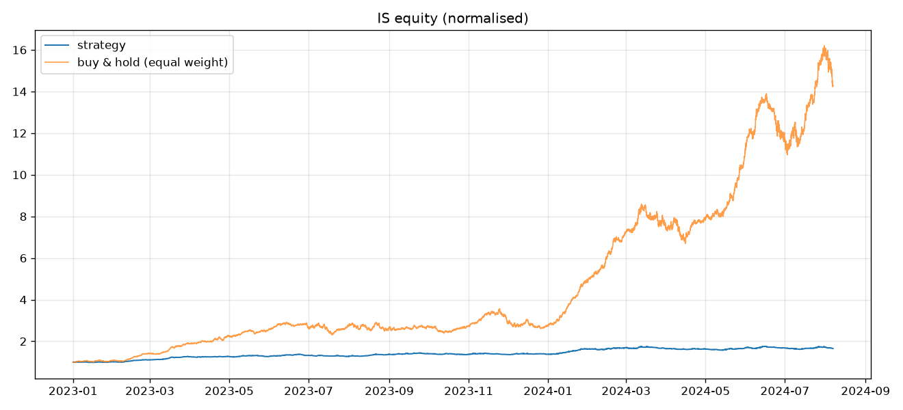

# trading-bot

Paper-trading-first crypto trading system for Binance spot: event-driven backtesting, walk-forward validation, position sizing and hard risk limits with a kill switch. Built to measure honestly whether a strategy has an edge, and to cap the damage while finding out.

> No profit claims. The strategies here are test subjects, not money makers.



Example run on real Binance data (2024-11 .. 2026-06, 4 assets, 1h bars): the strategy hit the 15% drawdown limit, the kill switch flattened all positions, and trading stopped. Buy & hold over the same period: -39% return, -61% max drawdown.

```
[IS] strategy (2024-11-17 .. 2026-06-24)
total_return            -15.00%
max_drawdown            -15.00%
n_trades                    182
[IS] buy & hold benchmark
total_return            -39.32%
max_drawdown            -61.40%
```

## Features

- Event-driven backtest engine with next-bar-open execution and a fee/slippage/spread cost model
- In-sample / out-of-sample split and walk-forward optimisation, always compared to a buy & hold benchmark
- Two example strategies: EMA trend-following and RSI/Bollinger mean reversion, both with a 4h regime filter
- Risk layer: volatility-based position sizing, daily loss limit, exposure limit, max-drawdown kill switch
- Paper trading on live market data with persisted state and graceful shutdown
- Live trading adapter, disabled by default behind three independent gates (config, environment variable, CLI flag)
- Reports as JSON metrics, CSV trades and PNG charts; static HTML status dashboard; optional Telegram alerts
- 98 pytest tests

## Tech stack

Python 3.12 · pandas / NumPy · ccxt (Binance API) · pydantic (config validation) · matplotlib · pytest · Docker

## Quick start

With Docker (offline demo on synthetic data):

```bash
docker build -t trading-bot .
docker run --rm -v "$PWD/reports:/app/reports" trading-bot
```

Without Docker:

```bash
python3.12 -m venv .venv && source .venv/bin/activate
pip install -r requirements.txt
pytest
python -m tradingbot backtest --synthetic
```

No API keys are needed for backtesting or paper trading.

## Usage

```bash
python -m tradingbot fetch-data                        # 2 years of 1h candles from Binance public endpoints
python -m tradingbot backtest                          # in-sample + 20% out-of-sample holdout vs. buy & hold
python -m tradingbot backtest --strategy meanrev_rsi_bb
python -m tradingbot walkforward                       # rolling optimise -> test -> roll (several minutes)
python -m tradingbot paper                             # paper trading on live data
python -m tradingbot dashboard                         # writes state/dashboard.html
```

With Docker, append the command: `docker run --rm -v "$PWD/reports:/app/reports" trading-bot walkforward`.

All parameters live in `config.yaml` and are validated at startup. Results land in `reports/<run_id>/`.

## Project structure

```
tradingbot/
├── pipeline.py      per-bar decision step shared by backtest, paper and live
├── data/            OHLCV download, CSV cache, causal 4h -> 1h alignment
├── strategies/      strategy interface, indicators, two strategies
├── risk/            position sizing, limits, kill switch
├── execution/       order validation, paper fills, Binance live adapter
├── backtest/        engine, metrics, walk-forward, plots
└── live/            paper/live loop with state persistence
tests/               unit and integration tests
deploy/              launchd / cron scripts for running paper trading 24/7 on macOS
docs/                full guide (GUIDE.md) and operations runbook (RUNBOOK.md)
```

## Technical decisions

Backtest, paper and live trading run through the same per-bar pipeline, so a strategy cannot behave differently in production than it did in testing. The hardest part was avoiding look-ahead bias: higher-timeframe (4h) signals are aligned to 1h bars only after the 4h bar has closed, and orders fill at the next bar's open, never at the bar that produced the signal. Risk limits sit outside the strategies and every order passes a validation layer, so no strategy can bypass them.

## Possible extensions

- Further exchanges through the existing broker adapter interface (ccxt supports many)
- `docker compose` setup for the 24/7 paper-trading loop instead of launchd/cron
- Additional strategies and a parameter-robustness report across walk-forward windows

## More

Strategy details, risk rules, known failure modes and the go/no-go checklist before live trading: [docs/GUIDE.md](docs/GUIDE.md). Day-to-day operations: [docs/RUNBOOK.md](docs/RUNBOOK.md).

## License

MIT, see [LICENSE](LICENSE).
